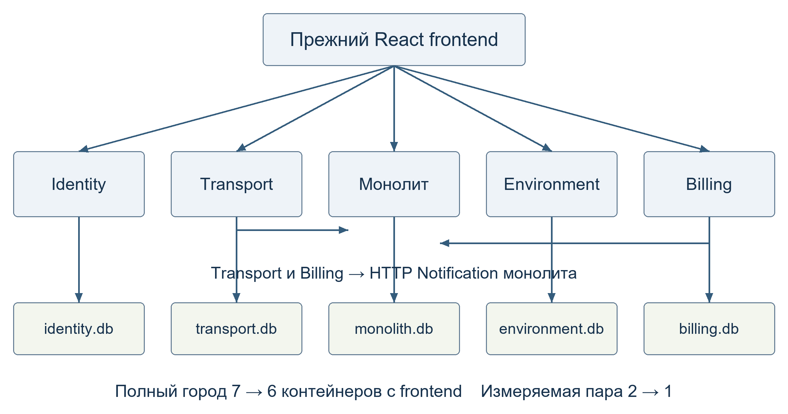

# SmartCity — модульный монолит

В учебном проекте «Умный город» сервисы **Utility** и **Notification** объединены
в одно приложение. При смене статуса заявки ЖКХ Utility сохраняет изменение
и вызывает `NotificationApi.send` внутри процесса. Identity, Transport,
Environment и Billing работают отдельными сервисами. Сайт на React и внешнее
REST API сохранены.



## Запуск

Нужны Docker и Docker Compose. Выполните команду из корня репозитория.

```bash
docker compose up -d --build --wait
```

Откройте <http://localhost:5173>. Для проверки сценария войдите под ролью USER
и создайте заявку ЖКХ. Затем войдите под ролью OPERATOR и измените её статус.
Обе роли доступны в [демонстрационных аккаунтах](smart-city/README.md#демонстрационные-аккаунты).

| Компонент | Порт по умолчанию |
|---|---:|
| Identity | 8001 |
| Transport | 8002 |
| Монолит (Utility и Notification) | 8003 и 8006 |
| Environment | 8004 |
| Billing | 8005 |
| Сайт | 5173 |

Swagger доступен по `http://localhost:<порт>/docs`, состояние API — по
`/health`. Порты и локальные настройки можно задать по [.env.example](.env.example).
Команда `docker compose down` останавливает город с сохранением SQLite в
томах Docker.

Исходный город с шестью микросервисами запускается из того же репозитория.
При стандартных портах сначала остановите целевой стенд.

```bash
docker compose -f smart-city/docker-compose.yml up -d --build --wait
docker compose -f smart-city/docker-compose.yml down
```

## Результаты сравнения

В изолированном тесте Utility и Notification монолит потреблял в среднем
**62,77 МБ** против **182,53 МБ** у двух микросервисов. Среднее время ответа
при смене статуса заявки составило **533,84 мс** против **411,29 мс**.
При сбое отправки в обеих версиях клиент получал `200` с сохранённым
статусом заявки, а уведомление оставалось `PENDING`.

## Материалы

- [Условие лабораторной работы](task.md).
- [Устройство проекта, запуск и проверки](docs/PLAN.md).
- [Контракт Utility и Notification](docs/API_CONTRACT.md).
- [Отчёт в PDF](docs/report/report.pdf) и [исходник отчёта](docs/report/report.md).
- [Воспроизведение замеров](smart-city-monolith/benchmarks/ORIGIN.md)
  и [результаты](smart-city-monolith/benchmarks/results/summary.csv).

## Команда

| Участник | Вклад |
|---|---|
| [Ашроев Евгений](docs/tasks/zheNYA.md) | Общая инфраструктура, стенды Docker Compose и интеграция |
| [Шилов Данил](docs/tasks/daNYA.md) | Модуль Utility, инструмент сравнения и замеры |
| [Белоножко Иван](docs/tasks/vaNYA.md) | Модуль Notification, схемы и отчёт |
