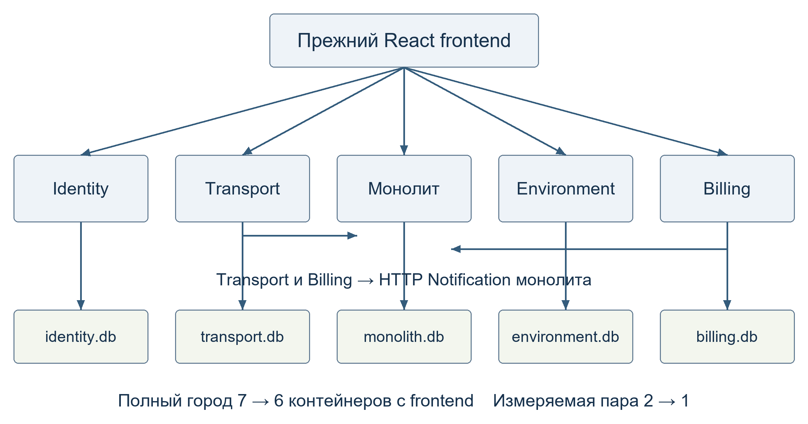

# Устройство и проверка SmartCityMonolith

В исходном SmartCity шесть FastAPI-сервисов и React-сайт. В итоговом городе
Utility и Notification работают в одном приложении, а Identity, Transport,
Environment и Billing сохранили отдельные процессы и базы. Происхождение
скопированного проекта описано в [SMARTCITY_ORIGIN.md](SMARTCITY_ORIGIN.md).



## Стенды

| Конфигурация | Состав | Назначение |
|---|---|---|
| [Корневой Compose](../compose.yml) | Монолит, четыре сервиса, сайт | Целевой город |
| [Исходный Compose](../smart-city/docker-compose.yml) | Шесть сервисов, сайт | Исходный город |
| [Compose монолита](../smart-city-monolith/compose.yml) | Utility и Notification в одном приложении, профиль `test` | Изолированный запуск монолита и тесты |
| [Compose микросервисной пары](../smart-city-monolith/benchmarks/compose.micro.yml) | Исходные Utility и Notification | Изолированное сравнение |

Полные города используют отдельные проекты Compose, сети и тома.
При стандартных портах запускайте их по очереди по [инструкции в README](../README.md#запуск).
Адреса API сайта и стандартный CORS следуют портам из корневого [.env.example](../.env.example).
В исходном городе семь контейнеров с учётом сайта, в целевом — шесть.

## Модули и данные

Приложение находится в [smart-city-monolith/](../smart-city-monolith/).
Оно использует Python 3.12, FastAPI, синхронный SQLAlchemy и один процесс
Uvicorn. Общий SQLite-файл `/data/monolith.db` содержит таблицы
`utility_issues` и `notification_notifications`. Каждый модуль работает
со своей таблицей. Общие настройки соединений и фабрика сессий находятся
в [app/database.py](../smart-city-monolith/app/database.py).
`python -m app.init_db` создаёт таблицы и добавляет демонстрационные записи.
Эту же инициализацию приложение выполняет при запуске.

1. Пользователь создаёт заявку через `POST /issues`.
2. Оператор или администратор меняет её статус через `PUT /issues/{issue_id}`.
3. Utility атомарно сохраняет новый статус и при фактическом изменении
   вызывает `NotificationApi.send`.
4. Notification открывает собственную сессию, фиксирует `PENDING` и после
   имитации отправки фиксирует `SENT` и `sent_at`.
5. Utility возвращает сохранённую заявку с `200`, в том числе при ошибке
   отправки уведомления.

Модуль Notification предоставляет фасад и публичную модель ответа.
Связь направлена от Utility к Notification. Таблицы разделены префиксами,
межмодульных внешних ключей и запросов к чужим таблицам нет.
Сетевой `POST /notifications` по-прежнему обслуживает Transport и Billing.
Форматы запросов, доступ по ролям и правила транзакций описаны в
[API-контракте](API_CONTRACT.md).

## Запуск монолита и тесты

Из каталога `smart-city-monolith/` можно запустить монолит и его тесты в Docker.

```bash
docker compose up -d --build --wait app
docker compose --profile test run --build --rm tests
docker compose --profile test down
```

API монолита доступно на портах `8003` и `8006`. При конфликте задайте
`UTILITY_PORT` и `NOTIFICATION_PORT` по [примеру настроек](../smart-city-monolith/.env.example).
Для локальной проверки установите [зависимости](../smart-city-monolith/requirements.txt)
в окружении Python 3.12 и из того же каталога выполните `python -m pytest -q`.
Тесты создают отдельные временные SQLite-файлы и проверяют независимые
сессии и конкурентные запросы.

Проверки конфигураций Compose запускаются из корня репозитория
командой `python -m unittest discover -s tests -v`. Для отчёта прошли
67 тестов монолита и 5 проверок Compose. В обоих городах через HTTP проверили
вход, заявки, транспорт, датчики, бронь и демо-оплату с уведомлениями.
Сохранены результаты для [исходного](../smart-city-monolith/benchmarks/results/original-smoke.json)
и [целевого](../smart-city-monolith/benchmarks/results/hybrid-smoke.json) стендов.

После смены статуса заявки в полном целевом городе можно прочитать последние
уведомления из SQLite. Выполните команду из корня репозитория.

```bash
docker compose exec -T app python -c 'import sqlite3; db = sqlite3.connect("file:/data/monolith.db?mode=ro", uri=True); print(db.execute("SELECT message, status, sent_at FROM notification_notifications ORDER BY created_at DESC LIMIT 5").fetchall())'
```

## Методика измерений и отказа

Для сравнения запускали только Utility и Notification, по очереди на
одном компьютере. У микросервисов два контейнера и два SQLite-файла.
У монолита один контейнер и один SQLite-файл. Версии общих пакетов и
параметры SQLite совпадали. Память учитывалась по всем контейнерам пары.

В каждой версии выполнили три прогона по 200 запросов с конкурентностью 10.
Для прогрева перед каждым прогоном использовали 20 отдельных заявок. Каждый
замеряемый PUT менял статус новой заявки с `NEW` на `IN_PROGRESS`.
После прогона проверяли по одному новому уведомлению `SENT` на заявку.

В эксперименте с `NOTIFICATION_FAIL_SEND=true` прямой запрос к Notification
возвращал `500`. Вызов Utility возвращал `200`, статус заявки сохранялся,
а уведомление оставалось в `PENDING`. После выключения режима новая
заявка получила уведомление `SENT`. Для воспроизведения доступны
[команды стендов](../smart-city-monolith/benchmarks/ORIGIN.md).
Карта вызовов, таблица замеров и выводы собраны в [отчёте](report/report.md).
