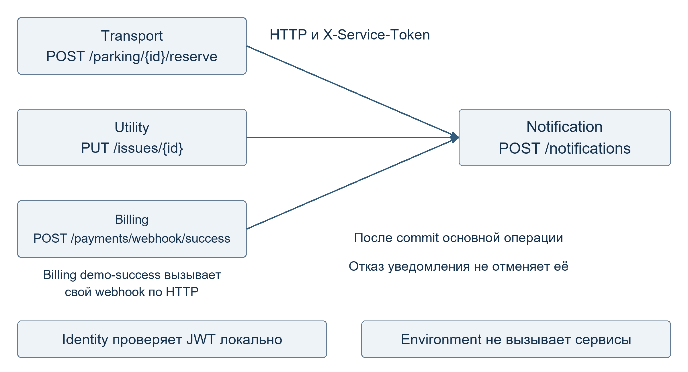
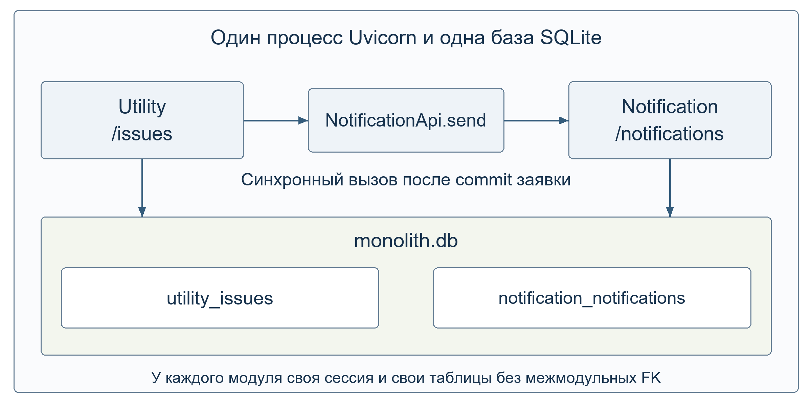
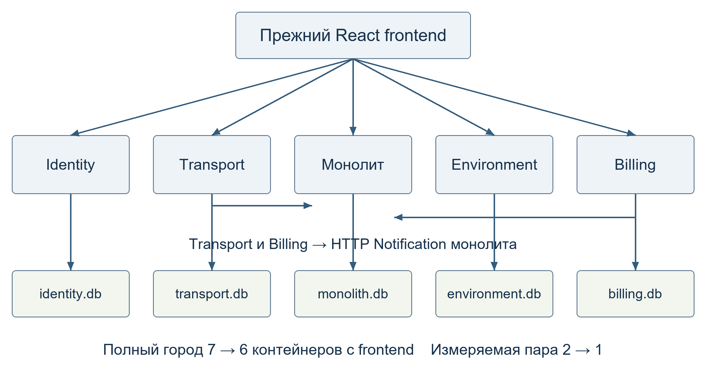

# Сравнение микросервисов и модульного монолита SmartCity

Лабораторная работа.
Авторы: **Ашроев Евгений, Шилов Данил, Белоножко Иван**.
Репозиторий: [SmartCityMonolith](https://github.com/dydojopka/SmartCityMonolith).

## Цель работы

В этой работе мы объединили два сервиса проекта «Умный город» в модульный
монолит. Нужно было заменить HTTP-запрос между ними обычным вызовом метода,
сохранить работу сайта и сравнить обе версии по скорости и расходу памяти.

Для объединения выбрали Utility, который работает с заявками ЖКХ, и
Notification, который отправляет уведомления. Остальные сервисы оставили
отдельными. Исходная версия города тоже сохранена в репозитории, поэтому
можно запустить любой из двух вариантов.

## Как взаимодействуют сервисы

За основу взяли [исходный SmartCity](https://github.com/dydojopka/SmartCity/tree/6983e58de588795731a548e31534794873835057/smart-city).
В нём шесть сервисов: Identity, Transport, Utility, Environment, Billing
и Notification. К Notification обращаются три из них.

| Кто вызывает | Куда обращается | Что происходит при отказе Notification |
|---|---|---|
| Transport: POST /parking/{id}/reserve | POST /notifications после новой брони | Бронь сохраняется, клиент получает 201. Ошибка уведомления записывается в лог |
| Utility: PUT /issues/{id} | POST /notifications при смене статуса | Новый статус сохраняется, клиент получает 200. Ошибка записывается в лог |
| Billing: POST /payments/webhook/success | POST /notifications после подтверждения оплаты | Платёж и оплаченный счёт сохраняются, клиент получает 200. Ошибка записывается в лог |

Сначала каждый сервис сохраняет результат своей основной операции, а уже
потом вызывает Notification. Поэтому сбой уведомления не отменяет бронь,
изменение заявки или оплату. Для вызова используется служебный токен
`X-Service-Token`, время ожидания ответа составляет 3 секунды.

У Billing есть ещё один HTTP-вызов: запрос
`POST /payments/{id}/demo-success` обращается к собственному обработчику
подтверждения оплаты. Если этот вызов не удался, клиент получает 502;
оплата при этом могла уже сохраниться, поэтому её состояние нужно проверить.
Identity, Environment и Notification сами другие сервисы не вызывают.
Проверка JWT выполняется на месте, без запроса к Identity.

## Почему выбрали Utility и Notification

Эти сервисы уже взаимодействуют в исходном проекте: при смене статуса
заявки её автор получает уведомление. Такой сценарий удобно повторять для
замеров: можно создавать новые заявки, не настраивая оплату и не занимая
парковочные места.

Сценарий работает следующим образом:

1. Пользователь создаёт заявку через `POST /issues`. Она сохраняется со статусом `NEW`.
2. Оператор или администратор меняет статус через `PUT /issues/{id}`, например на `IN_PROGRESS`.
3. Utility сохраняет новый статус. Если статус уже такой же, повторного уведомления не будет.
4. В микросервисной версии Utility отправляет HTTP-запрос `POST /notifications`. В монолите он вызывает метод `NotificationApi.send`.
5. Notification сохраняет уведомление со статусом `PENDING` («ожидает отправки»). Затем имитирует отправку и меняет статус на `SENT` («отправлено»), записывая время отправки.
6. Клиент получает код 200 и данные обновлённой заявки. Если уведомление не отправилось, заявка всё равно остаётся в новом статусе.

Мы выбрали **вариант А - прямой вызов метода**. Для одного вызова между двумя
модулями это проще, чем вводить внутренние события. Порядок действий остаётся
понятным: сохранить заявку, вызвать отправку уведомления и вернуть ответ.

## Как устроен монолит

Новое приложение находится в `smart-city-monolith/`. Код заявки и уведомления
разделён на каталоги `app/modules/utility` и `app/modules/notification`.
Используется тот же стек, что и в исходном проекте: Python 3.12, FastAPI,
SQLAlchemy и SQLite. Монолит запускается одним серверным процессом.

Для обращения к Notification сделан класс `NotificationApi`. Это публичный
интерфейс модуля: Utility вызывает его метод `send`, а сам класс проверяет
переданные данные и сохраняет уведомление. Utility не обращается к таблице
Notification. Обратного вызова из Notification в Utility тоже нет.

Оба модуля используют один файл `monolith.db`, но работают со своими таблицами:
`utility_issues` для заявок и `notification_notifications` для уведомлений.
Каждый модуль обращается только к своим таблицам.
В задании показаны варианты разделения таблиц для PostgreSQL и MySQL.
Мы оставили исходную SQLite и разделили таблицы префиксами в названиях.
Менять СУБД ради объединения сервисов не стали.

Команда `python -m app.init_db` создаёт таблицы и добавляет тестовые записи.
Её можно запускать повторно: уже существующие записи не удаляются.

**Внешний ключ между модулями мы не добавляли.** Такой ключ мог бы проверять,
что уведомление связано с существующей заявкой. Но тогда таблицы двух модулей
зависели бы друг от друга. Если позже снова сделать Notification отдельным
сервисом, эту связь пришлось бы переделывать. Сейчас отдельного поля
`issue_id` у уведомления нет: номер заявки записывается в текст сообщения.

## Что осталось от полного города

Identity, Transport, Environment и Billing продолжают работать отдельно,
каждый со своей базой. Старый React-сайт тоже сохранён. Изменились только
Utility и Notification: теперь это два модуля одного приложения.

Внешние адреса и форматы запросов сохранили. Прежние порты 8003 и 8006 ведут
к одному монолиту. Вход по JWT и ограничения по ролям продолжают работать.
Повтор создания заявки с тем же ключом не создаёт копию, а повтор того же
статуса не отправляет уведомление ещё раз.

Endpoint `POST /notifications` оставили, потому что его по-прежнему вызывают
Transport и Billing. Он защищён служебным токеном. Utility внутри монолита
этот HTTP-endpoint больше не использует.

Весь исходный город вместе с сайтом состоит из 7 контейнеров, новый - из 6.
Для замеров ниже запускали только выбранную пару: 2 контейнера микросервисов
или 1 контейнер монолита. Память всего города в эту таблицу не входит.

После объединения успешно прошли 67 тестов монолита и 5 проверок настроек Docker Compose.
В обеих версиях через API проверили вход пользователей с разными ролями,
заявки, транспорт, датчики, бронь и демо-оплату. Уведомления от заявок,
бронирования и оплаты сохранялись. Также проверили запуск сайта и доступ
к его файлам; ручной показ в браузере описан в конце отчёта.

## Как проводили замеры

Обе версии запускали по очереди на одном компьютере. Во время измерений
остальные сервисы города были остановлены. Компьютер: AMD Ryzen 7 5800X,
16 логических ядер, Windows с WSL2 и Ubuntu 20.04. Для Docker было доступно
15.54 ГиБ памяти. Использовались Docker 26.1.3, Python 3.12.15 и SQLite 3.46.1.
Версии общих библиотек у обеих систем совпадали.

Файлы баз обеих версий лежали на одном NVMe SSD, в отдельных папках Windows,
подключённых к контейнерам. Настройки SQLite оставили исходными:
`journal_mode=delete`, `synchronous=2`, `foreign_keys=1`, ожидание записи
до 30 секунд. WAL не включали. У микросервисов два файла БД, у монолита один.

Сначала попробовали запуск на медленном диске. Часть вызовов Notification
не укладывалась в 3 секунды, поэтому эту попытку в итоговую таблицу не включали.
После этого обе версии проверили на одном NVMe, не меняя тайм-аут и настройки
SQLite. Подробности этой проверки сохранены в `results/storage-check.json`.

Для каждой версии сделали **3 запуска по 200 измеряемых запросов**, одновременно
выполнялось не больше 10 запросов. Перед каждым запуском создавали 220 новых
заявок: 20 использовали для прогрева, оставшиеся 200 - для замера. Каждый
запрос один раз менял свою заявку с `NEW` на `IN_PROGRESS`.
Создание заявок, прогрев и проверка результатов в измеряемое время не входили.

Нагрузку отправлял один и тот же скрипт `benchmarks/run.py`. Он измерял время
каждого запроса, а количество запросов в секунду считал как 200, делённые
на время всего запуска. После каждого запуска проверяли базу: должны быть
200 изменённых заявок и 200 новых уведомлений `SENT` именно для этих заявок.
Во всех шести принятых запусках эта проверка прошла.

Память снимали несколько раз во время нагрузки через `docker stats`.
У микросервисов складывали память двух приложений, у монолита брали память
одного. Сначала считали среднее по снимкам каждого запуска, затем по трём
запускам. В каждом было не меньше двух снимков под нагрузкой. Значения Docker
перевели в МБ: 1 МБ = 1 000 000 байт. Отдельного сервера БД нет, SQLite
работает внутри приложений. Генератор нагрузки в эти показатели не включали.

Код для замеров сохранён в [версии 9e94061](https://github.com/dydojopka/SmartCityMonolith/tree/9e940616bff9e7f415e650fd95d9d6bad5c6e4ae).
Исходные данные всех запусков находятся в
`smart-city-monolith/benchmarks/results/`. Там же записаны точные версии
библиотек, времена запросов и снимки памяти. Из-за ограничений сети WSL образы
собирали из заранее скачанных пакетов; набор пакетов был одинаковым.

## Результаты

В основной таблице указаны средние значения по трём запускам.

| Показатель выбранной пары | Микросервисы | Модульный монолит |
|---|---:|---:|
| Среднее время ответа, мс | 411.29 | 533.84 |
| Запросов в секунду | 23.98 | 18.62 |
| Память приложений, МБ | 182.53 | 62.77 |
| Контейнеров приложений | 2 | 1 |
| Команд запуска | 1 | 1 |

Оба готовых стенда запускаются одной командой `docker compose up -d --wait`
с нужным Compose-файлом. Установку зависимостей и проверочные команды
в это число не включали.

Результаты отдельных запусков:

| Версия и запуск | Время ответа, мс | Запросов/с | Память, МБ |
|---|---:|---:|---:|
| Микросервисы 1 | 484.88 | 20.07 | 175.69 |
| Микросервисы 2 | 387.84 | 25.04 | 184.17 |
| Микросервисы 3 | 361.13 | 26.81 | 187.75 |
| Монолит 1 | 470.94 | 20.76 | 61.92 |
| Монолит 2 | 480.51 | 20.19 | 62.98 |
| Монолит 3 | 650.07 | 14.91 | 63.42 |

Монолит занял примерно на **66% меньше памяти**, но среднее время ответа
оказалось примерно на **30% больше**. Удаление HTTP-вызова само по себе
не дало ускорения. Возможно, сказалось то, что теперь оба модуля записывают
данные в один файл SQLite и ждут друг друга. Для проверки этой причины
понадобились бы отдельные замеры. Эти цифры относятся к нашей нагрузке
на этом компьютере, а не ко всем монолитам и микросервисам.

## Что происходит при отказе уведомлений

В обеих версиях включили `NOTIFICATION_FAIL_SEND=true`. При этом Notification
выбрасывает ошибку после сохранения `PENDING`, но до отправки. Для проверки
каждый раз создавали новую заявку и меняли её статус.

| Наблюдение | Микросервисы | Монолит |
|---|---|---|
| Прямой POST /notifications с правильным токеном | 500 | 500 |
| Ответ на изменение заявки | 200, IN_PROGRESS | 200, IN_PROGRESS |
| Уведомление в базе при отказе | PENDING, sent_at=NULL | PENDING, sent_at=NULL |
| Повтор того же статуса после выключения отказа | Нового уведомления нет | Нового уведомления нет |
| Другая новая заявка после выключения отказа | SENT, время отправки записано | SENT, время отправки записано |
| Старое уведомление после восстановления | Осталось PENDING | Осталось PENDING |

Клиенту возвращается успешный ответ, потому что заявка уже сохранена.
Ошибка уведомления записывается в лог. Такой порядок был и в исходном Utility,
мы сохранили его в монолите: сначала сохранить заявку, затем вызвать
Notification и перехватить ошибку только этого вызова. Если бы ошибка
уведомления прерывала основную операцию, именно так стоило бы изменить код.
Ошибки при сохранении самой заявки скрывать нельзя.

После выключения отказа новая заявка получила `SENT`. Старое уведомление
`PENDING` само не отправилось. Повтор того же статуса тоже его не отправляет.
Для этого нужно было бы добавить повторную отправку неотправленных
уведомлений и защиту от дублей. В этой работе такой механизм не делали.

## Выводы

После объединения стало меньше контейнеров и заметно снизился расход памяти.
Два модуля проще запускать вместе, а их взаимодействие можно проследить
в одном приложении. При этом на наших замерах монолит оказался медленнее.

У микросервисов есть свои преимущества: их можно обновлять и запускать
отдельно, а при росте нагрузки увеличивать число экземпляров только нужного
сервиса. Но нужно поддерживать несколько приложений и HTTP-связь между ними.
У монолита запуск общий, а сбой всего процесса затронет оба модуля.
Кроме того, важно следить, чтобы модули не начали обращаться к чужим таблицам.

Для нашего учебного города с одной командой и умеренной нагрузкой мы выбрали
бы объединение Utility и Notification: оно экономит память и упрощает запуск.
Если важнее время ответа или независимое обновление сервисов, стоит оставить
их отдельными и провести дополнительные тесты под нужную нагрузку.
Совмещать подходы удобно, когда тесно связанные части объединяются,
а сервисы с другими требованиями к нагрузке или обновлениям остаются отдельными.
В нашем проекте именно так сохранены ещё четыре сервиса.

Неожиданным оказалось, что отказ от HTTP не ускорил этот сценарий.
Ещё один результат: успешное сохранение заявки при сбое уведомления уже
обеспечивал исходный код. Объединение сервисов сохранило это поведение,
но не решило проблему повторной отправки уведомлений.

## Воспроизведение и показ

Можно пройти такой порядок:

1. Из корня репозитория выполнить `docker compose up -d --build --wait`.
2. Открыть сайт, войти пользователем и создать заявку. Затем войти оператором и изменить её статус.
3. Показать обновлённую заявку, уведомление и две таблицы в общем файле базы данных.
4. Проверить остальные страницы города, новую бронь и демо-оплату с уведомлениями.
5. На отдельном стенде включить отказ Notification. Показать, что заявка сохранилась, а уведомление осталось `PENDING`. Выключить отказ и проверить другую новую заявку.
6. Показать таблицу замеров и исходные результаты в `benchmarks/results/`.

Тесты монолита запускаются командой `python -m pytest -q` из
`smart-city-monolith/`. Проверки Compose - командой
`python -m unittest discover -s tests -v` из корня репозитория.
Команды запуска обеих версий, измерений и эксперимента с отказом описаны
в `smart-city-monolith/benchmarks/ORIGIN.md`.
